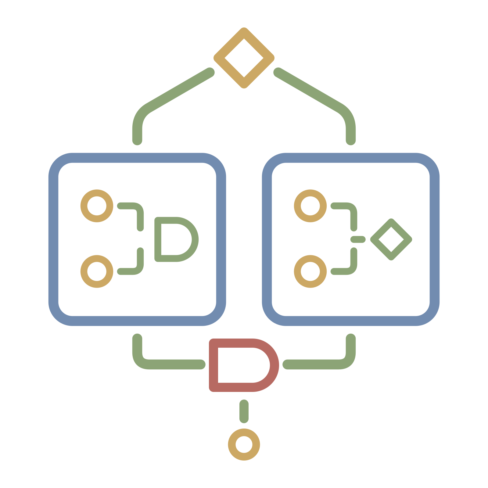

Nature · AI · People

📄 [Résumé](https://resume.tiger-lily-plants.com) · 🔗 [LinkedIn](https://www.linkedin.com/in/emmeowzing/)

I'm a platform engineer with a background in SRE, cloud infrastructure, and developer tooling. I build tools for understanding complex systems, testing their behavior, and making them easier to operate. I also run Tiger Lily Plants, where my interests in plants, terrariums, and software meet.

## Current work

- [Consilience LLC](https://github.com/enterprises/consilience), a holding company guiding these ventures toward harmony between Nature, AI, and People.
  - [Astrivant LLC](https://github.com/astrivant) spans AI and the infrastructure around it.
  - [Tiger Lily Plants LLC](https://github.com/tigerlilyplants) brings botany and engineering together to reimagine the spaces we inhabit.
  - [Lavenvale LLC](https://github.com/lavenvale) makes complex systems readable and navigable, connecting people.
